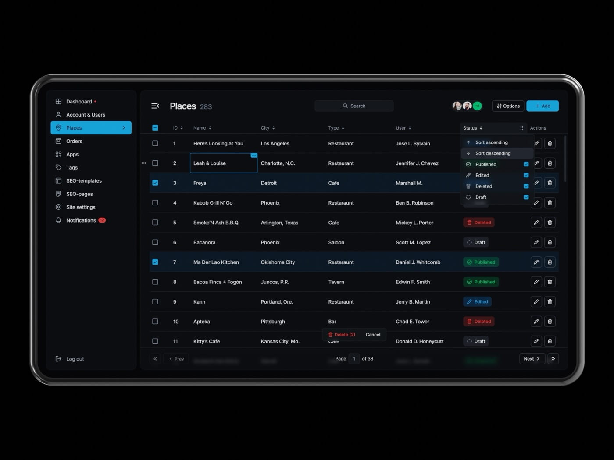

# ByTerm — торговый терминал

Веб-терминал для активной торговли: график, стакан, портфель и заявки в одном окне. До проекта трейдеры держали часть данных во внешних таблицах, а заявку собирали через длинную форму. Роль — продуктовый дизайнер: исследование, рабочее пространство, состояния.

## Задача

Терминал нужен трейдерам, которые проводят у экрана несколько часов и совершают десятки сделок в день. Прежний интерфейс требовал шести шагов на заявку, а ошибки ввода замечали уже после отправки.

Цель: сократить путь до заявки, снизить число ошибок и дать возможность собрать рабочее пространство под свою стратегию.

## Моя роль

Продуктовый дизайнер. Провёл интервью с трейдерами, разобрал текущие терминалы, собрал структуру экрана, состояния и настройку раскладок. Работал с продактом, двумя разработчиками и аналитиком.

## Процесс

Исследование. Девять интервью с трейдерами разного опыта и три записи экрана во время торговой сессии. Смотрели, какие данные нужны постоянно, а какие открывают раз в день.

Рабочее пространство. Экран разбит на панели: график, стакан, портфель, лента заявок. Панели можно переставлять и сворачивать; состояние сохраняется для пользователя.

Заявка. Форма открывается из стакана и из графика, подставляет цену и объём, показывает расчёт суммы и комиссии до отправки. Ошибки валидации появляются у поля, а не после отправки.

Плотность. Для данных подобраны размеры строк и шрифты, которые читаются при быстром сканировании. Проверяли на мониторах 24 и 27 дюймов и на ноутбуке.

## Что изменилось

- Заявка: шесть шагов → два, с расчётом суммы до отправки.
- Ошибки: сообщение после отправки → подсказка у поля.
- Рабочее место: фиксированная раскладка → настраиваемые панели с сохранением.
- Данные: часть во внешних таблицах → портфель и история в терминале.

## Результаты

- Выставление заявки: около 40 секунд → 15 секунд в тестах.
- Ошибки ввода при отправке сократились примерно на четверть.
- Три готовые раскладки: скальпинг, свинг, наблюдение.
- Терминал используют на трёх мониторах без отдельной версии интерфейса.

<video controls playsinline preload="metadata" src="assets/demo.mp4" poster="assets/cover.jpg"></video>

