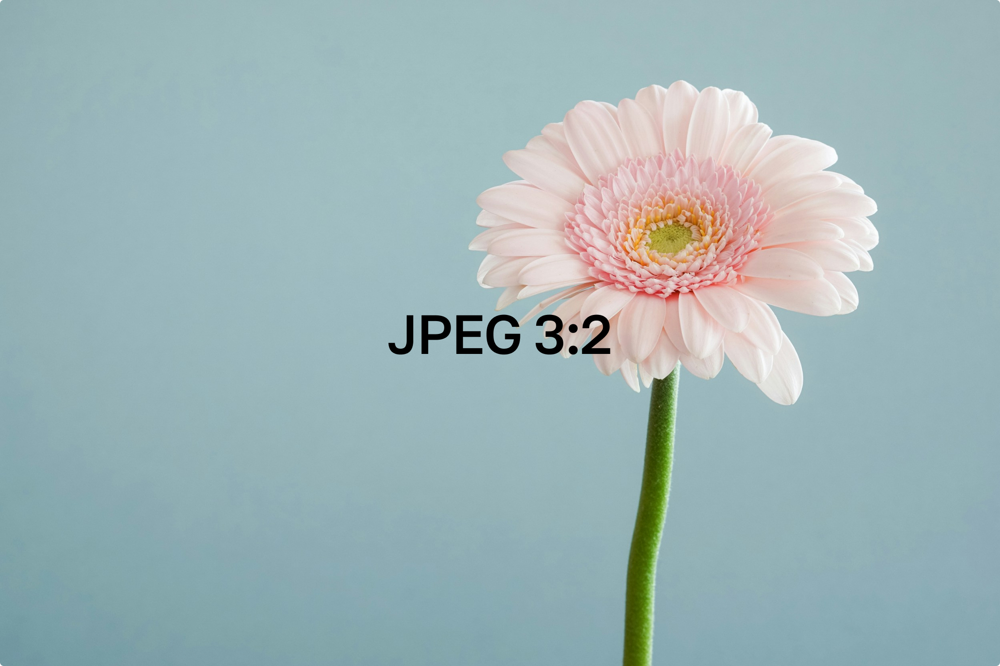

# Zinda — цифровой банк для бизнеса

Zinda — банк для малого и среднего бизнеса в Таджикистане. Нужно было с нуля собрать интерфейс личного кабинета для веба и мобильного: счёт, платежи, зарплатный проект и валютный контроль — без визита в отделение. Я отвечал за дизайн как лид: от исследования до передачи в разработку.

## Задача

До запуска предприниматель закрывал почти любой вопрос через отделение: бумажное поручение, подпись, звонок менеджеру. Платёж контрагенту занимал два-три дня, статус приходилось выяснять по телефону, а часть операций вообще не помещалась в один визит.

Цель звучала так: предприниматель должен проводить платёж сам, видеть его статус и понимать причину отказа — без обращения в поддержку. Отдельно нужно было сделать базу для внутренних продуктов банка, чтобы новые сервисы собирались не с нуля.

## Моя роль

Дизайн-лид. Вёл исследование и структуру, собрал дизайн-систему, отвечал за ревью макетов и приёмку вёрстки. В команде были продакт, три разработчика и аналитик; с ними фиксировали ограничения по срокам и интеграциям.

## Процесс

### Исследование

Начали с двенадцати интервью: владельцы небольшого бизнеса, бухгалтеры, кассиры. Просили показать, как они проводят платёж сегодня, а не рассказывать, каким видят новый кабинет. Быстро выяснилось, что главная боль не в количестве кликов, а в неопределённости: человек не понимает, дошёл ли платёж и что делать, если он завис.

### Структура

Собрали карту задач и свели её к четырём разделам: счёт и выписка, платежи, зарплата, документы. Всё, что не про ежедневную работу — настройки, лимиты, шаблоны — убрали на второй уровень. Проверяли структуру на карточках с бухгалтерами до отрисовки экранов.

### Дизайн-система

Параллельно с макетами собрали библиотеку: токены цветов и типографики, состояния кнопок и полей, таблицы, пустые состояния, скелетоны загрузки. К релизу — больше шестидесяти компонентов и тёмная тема для тех, кто работает вечером.

### Тестирование

Три итерации прототипа на реальных сценариях: создать платёж, отправить в банк, найти зависший, повторить шаблон. После каждой итерации список гипотез сокращался: часть решений мы просто выкинули, потому что люди их не замечали.

## Что изменилось

- **Платёж.** Было: бумажное поручение и звонок менеджеру. Стало: форма в кабинете с проверкой реквизитов и статусом каждой стадии.
- **Статус.** Было: «уточните у менеджера». Стало: лента событий с причиной отказа и кнопкой «исправить».
- **Зарплата.** Было: отдельная выгрузка и подпись в отделении. Стало: реестр в кабинете с проверкой перед отправкой.
- **Новые сервисы.** Было: каждый продукт со своим набором компонентов. Стало: общая библиотека и правила.

## Результаты

За четыре месяца прошли путь от исследования до релиза в вебе и мобильном.

- платёж в пилоте: два-три дня → пятнадцать минут;
- обращений в поддержку по теме «как провести платёж» стало меньше примерно на 40%;
- больше шестидесяти компонентов в дизайн-системе, две платформы;
- следующий продукт банка собрали на библиотеке без нового визуального языка.

## Итог

Проект научил простой вещи: в банковском интерфейсе доверие важнее скорости. Человек готов подождать лишний экран, если на нём понятно, что происходит с его деньгами. Поэтому статусы, причины отказа и возможность вернуться на шаг назад оказались важнее любых сокращений пути.

<video controls playsinline preload="metadata" src="assets/demo.mp4" poster="assets/cover.jpg"></video>

