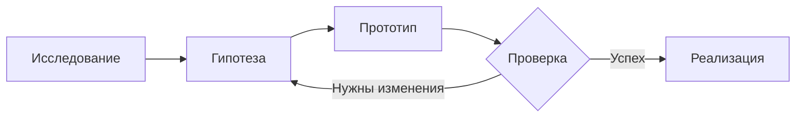

# Платформа дизайн-системы


**Демонстрационный кейс.** Ниже — вымышленные задачи, решения и результаты для проверки вёрстки. Изображения и видео — тестовые материалы. Направление проекта: единый набор компонентов для B2B-продуктов.

## Цель

Сократить путь от первого знакомства с продуктом до завершения ключевого действия. Команда хотела сделать интерфейс понятным для новых пользователей и сохранить привычные сценарии для опытных. Мы договорились проверять решения на задачах, а не оценивать их только по внешнему виду.

## Результаты

В учебном примере доля успешно выполненных заданий выросла с **62% до 84%**, а медианное время прохождения сценария сократилось с **4 минут до 2,5 минут**. Это условные цифры, а не результаты реального проекта. Команда получила прототип, библиотеку компонентов и список гипотез для следующей итерации.

## Моя роль в проекте

Я отвечал за исследование, структуру сценариев, интерактивный прототип и визуальный дизайн. Вместе с продакт-менеджером сформулировал критерии успеха, с разработчиками обсудил ограничения, а после тестирования подготовил спецификацию состояний и проверил сборку.

## Процесс

Мы начали с разбора текущего пути пользователя и собрали вопросы, на которые не могли ответить по аналитике.
Затем провели несколько интервью и попросили участников показать, как они решают задачу сегодня.
Важно было увидеть реальные обходные пути, а не только услышать пожелания к будущему интерфейсу.
Наблюдения сгруппировали по этапам сценария и отдельно отметили места, где человек терял контекст.
Для обсуждения подготовили [интерактивный прототип в Figma](https://www.figma.com/) и короткий список проверяемых гипотез.
На первой итерации мы сократили число обязательных полей и перенесли вспомогательные действия в дополнительные настройки.
После этого сравнили два варианта навигации и проверили, понимают ли участники названия разделов без подсказок.
Ошибки и пустые состояния проектировали одновременно с основным сценарием, чтобы пользователь всегда видел следующий шаг.
Решения обсуждали с разработчиками небольшими порциями и фиксировали причины выбора в комментариях к макету.
Отдельное внимание уделили клавиатурной навигации, контрасту и принципам [доступного интерфейса](https://www.w3.org/WAI/fundamentals/accessibility-intro/).
В финале повторили тестирование на обновлённом прототипе и разделили замечания на критические и те, что можно проверить после запуска.
Так появился план следующей итерации с понятными владельцами задач и критериями готовности.


После первой проверки мы не стали менять весь интерфейс сразу. Выбрали один основной сценарий и довели его до состояния, в котором можно проверить гипотезу. Это помогло отделить проблемы структуры от вопросов визуального оформления. Остальные идеи сохранили в бэклоге и связали с конкретными наблюдениями из интервью.

### Что изменили

| Наблюдение | Решение |
| --- | --- |
| Пользователи не замечали основное действие | Сделали его заметнее и уточнили название |
| Форма требовала слишком много данных | Оставили обязательными только необходимые поля |
| После ошибки было непонятно, как продолжить | Добавили объяснение и действие для восстановления |
| Длинные названия ломали узкие экраны | Проверили переносы и адаптивные состояния |

### Сравнение сценариев

Демонстрационные данные для широкой таблицы. Если она не помещается, прокрутите её по горизонтали.

| Сценарий | Аудитория | Устройство | Участники | Успех до | Успех после | Время до | Время после | Основная проблема | Решение |
| --- | --- | --- | --- | --- | --- | --- | --- | --- | --- |
| Первый вход | Новые пользователи | Телефон | 8 | 50% | 88% | 2 мин 40 с | 1 мин 20 с | Слишком много обязательных полей | Сократили форму регистрации |
| Поиск нужного раздела | Активные пользователи | Ноутбук | 10 | 60% | 90% | 1 мин 30 с | 45 с | Неочевидные названия пунктов меню | Перегруппировали навигацию |
| Настройка профиля | Все пользователи | Планшет | 6 | 67% | 83% | 3 мин | 1 мин 50 с | Настройки разбросаны по разным экранам | Собрали их в одном разделе |
| Восстановление после ошибки | Повторные пользователи | Телефон | 8 | 38% | 88% | 2 мин 10 с | 35 с | Непонятно, что делать дальше | Добавили объяснение и повтор действия |

### Принципы решения

- Один главный сценарий на каждом этапе.
- Понятные подписи вместо внутренних терминов команды.
- Сохранение введённых данных при ошибке.
- Предсказуемые состояния компонентов:
  - загрузка;
  - пустой результат;
  - ошибка и повторная попытка.

### Последовательность работы

1. Сформулировали задачу и ограничения.
2. Собрали наблюдения и карту сценария.
3. Подготовили прототип и провели тестирование.
4. Уточнили дизайн и передали спецификацию.
5. Проверили реализацию и составили план улучшений.

#### Движение и обратная связь

GIF ниже нужен для проверки анимированных иллюстраций. В реальном кейсе здесь может быть переход между состояниями интерфейса.


#### Видео прототипа

Видео запускается вручную: доступны звук, пауза, перемотка и полноэкранный режим.

<video controls playsinline preload="metadata" src="assets/demo.mp4" poster="assets/cover.jpg"></video>

*Тестовая видеозапись для проверки плеера в статье.*

##### Детали интерфейса


###### Что проверим дальше

Проверим, сохраняются ли улучшения на более широкой аудитории и какие сценарии требуют отдельной итерации.

> Хороший результат исследования — не список пожеланий, а ясное понимание проблемы и способ проверить решение.

---

**Материалы:** [обсудить проект](https://t.me/fedoros/1145), [другой пример кейса](../liqesis/liqesis-case.md).

---

# Проверка оформления Markdown

Это тестовый раздел, а не часть реального проекта. Здесь собраны основные конструкции Markdown и распространённые расширения. Смотрим на переносы, отступы, вложенность и отображение на узком экране. Раздел с расширениями ниже намеренно показывает синтаксис, который текущий сайт ещё не поддерживает полностью.

## Заголовок второго уровня

Короткое описание раздела сразу после заголовка.

### Заголовок третьего уровня с достаточно длинным названием для проверки переноса на несколько строк

Текст между заголовками помогает проверить вертикальные интервалы.

#### Заголовок четвёртого уровня

Небольшой параграф с пояснением решения.

##### Заголовок пятого уровня

Ещё один уровень вложенности внутри исследования.

###### Заголовок шестого уровня

Самый маленький заголовок должен отличаться от основного текста.

Альтернативная запись заголовка второго уровня
---------------------------------------------

Этот заголовок записан подчёркиванием, без символов решётки.

## Текст и выделения

Обычный текст, **полужирный**, *курсив*, ***полужирный курсив***, ~~зачёркнутый~~ и **полужирный с *курсивом внутри***. Код внутри строки: `button.primary`, `--color-text-primary`, `user.profile.settings.notifications.enabled`. Сочетания: [**жирная ссылка**](https://www.figma.com/), [*ссылка курсивом*](https://www.w3.org/WAI/) и `код с пробелами`.

Это отдельный абзац. «Кавычки», длинное тире — и многоточие… Неразрывный пробел: 10 000. Символы: ©, →, ±, ×, ≤, ≥. Эмодзи: ✅ 🔍 💡. Латиница рядом с кириллицей: Design system / Дизайн-система.

Первая строка с принудительным переносом.\
Вторая строка того же абзаца, без нового параграфа.

А здесь первая строка исходника
и вторая строка исходника: обычный перенос в MD объединяется в один параграф.

Экранированные символы: \*это не курсив\*, \# это не заголовок, \[это не ссылка\], \_подчёркивания\_. Обратная кавычка внутри кода: `` `пример` ``.

Проверка длинного слова без пробелов: SuperLongUnbrokenComponentNameForTestingResponsiveArticleLayoutAndOverflowOnSmallMobileScreens1234567890.

## Ссылки разных видов

[Обычная внешняя ссылка](https://www.figma.com/), [ссылка с title](https://www.w3.org/WAI/ "Рекомендации по доступности") и [ссылка через определение][markdown-demo-reference].

Автоматическая ссылка в угловых скобках: <https://example.com/design-system>. Адрес без оформления: https://example.com/research/results?segment=new-users&device=mobile.

Email: <designer@example.com> — демонстрационный адрес для проверки существующего копирования почты.

[Открыть другой локальный кейс](../liqesis/liqesis-case.md).

[markdown-demo-reference]: https://www.w3.org/WAI/ "Доступность интерфейсов"

## Цитаты

> Короткая цитата участника: «Я хочу понимать, что произойдёт после нажатия».

Обычный текст между цитатами.

> **Развёрнутая цитата из исследования.** Пользователь не заметил подтверждение действия и повторно отправил форму.
>
> Второй абзац той же цитаты: важно проверить расстояние между абзацами внутри общей вертикальной линии.
>
> - Наблюдение в виде списка.
> - Ещё одно наблюдение со [ссылкой на материалы](https://example.com/research).
>
> > Вложенная цитата: комментарий наблюдателя внутри цитаты участника.

## Списки и вложенность

- Первый пункт маркированного списка.
- Второй пункт с длинным текстом, который на мобильном экране должен переноситься на несколько строк с одинаковым отступом у всех продолжений.
  - Второй уровень вложенности.
    - Третий уровень вложенности.
    - Ещё один пункт третьего уровня.
  - Возвращение на второй уровень.
- Последний пункт первого уровня.

### Нумерованный список со смешанной вложенностью

1. Подготовить исследование.
   - Согласовать аудиторию.
   - Составить сценарий.
     1. Проверить первый вход.
     2. Проверить повторный вход.
2. Провести интервью.
3. Собрать результаты.

### Список с абзацами и цитатой внутри

1. **Первый этап.** Сформулировать гипотезу.

   Второй абзац внутри первого пункта. Он должен сохранять вложенность и не сливаться со следующим пунктом.

   > Цитата, относящаяся только к первому этапу.

2. **Второй этап.** Проверить гипотезу на прототипе.

### Нумерация с произвольного числа

7. Седьмой этап.
8. Восьмой этап.
9. Девятый этап.

## Код

Код внутри предложения: `const conversion = completed / started;`. Ниже блок с указанным языком; подсветка синтаксиса сейчас не подключена.

```javascript
const research = {
  participants: 12,
  completed: 9,
  devices: ['mobile', 'desktop'],
};

function successRate({ participants, completed }) {
  return `${Math.round(completed / participants * 100)}%`;
}

console.log(successRate(research));
```

### Блок без указания языка

```
Начало → Выбор продукта → Заполнение формы → Подтверждение
ОченьДлиннаяСтрокаБезПробеловДляПроверкиПоведенияКодаНаМобильномЭкране01234567890123456789012345678901234567890
```

### Код через отступ в четыре пробела

    GET /api/research/results
    status: 200
    message: "Исследование завершено"

### HTML как текст, без исполнения

```html
<button type="button" class="primary">
  Продолжить
</button>
```

## Таблица с форматированием и выравниванием

Колонки ниже заданы как левая, центральная и правая. Сейчас рендерер удаляет настройки выравнивания — это отдельный пример для проверки.

| Показатель слева | Статус по центру | Значение справа |
| :--- | :---: | ---: |
| **Успех сценария** | Готово | 84% |
| *Время выполнения* | Проверяем | 2,5 мин |
| [Материалы](https://example.com) | `draft` | 12 |
| Пустая ячейка справа | — | |
| Экранированная черта \| внутри ячейки | ~~Отменено~~ | 0 |
| Длинное название метрики для проверки переноса текста внутри ячейки | Требуется дополнительная проверка | 1 234 567 |

Двухколоночная и широкая десятиколоночная таблицы находятся выше, в основном тексте кейса.

## Медиа и подписи

Изображения, вертикальная иллюстрация, GIF и видео с управлением уже представлены выше. Здесь — изображение-ссылка, чтобы проверить сочетание двух конструкций:

[](assets/process.jpg)

Картинка с подписью через title:


## Горизонтальный разделитель

Текст перед разделителем.

---

Текст после разделителя.

## Расширения Markdown: проверка текущих ограничений

Это не универсальная часть Markdown. Ниже оставлены настоящие примеры синтаксиса, чтобы видеть текущее поведение сайта. Формулы, сноски, диаграммы и специальные выделения требуют дополнительных расширений; их рендеринг пока не подключён.

### Список задач GFM

Marked создаёт чекбоксы, но текущая очистка HTML их удаляет. Поэтому сейчас будут видны только подписи задач.

- [x] Провести интервью.
- [x] Собрать прототип.
- [ ] Проверить адаптивную версию.
  - [x] Телефон.
  - [ ] Планшет.

### Формула внутри строки

Конверсия: $CR = \frac{N_{completed}}{N_{started}} \times 100\%$. Изменение: $\Delta CR = CR_{after} - CR_{before}$.

### Формула отдельным блоком

$$
\bar{x} = \frac{1}{n}\sum_{i=1}^{n} x_i
$$

$$
\sigma = \sqrt{\frac{1}{n}\sum_{i=1}^{n}(x_i - \bar{x})^2}
$$

### Сноски

Оценка получена на небольшой тестовой выборке[^sample]. Результаты требуют повторной проверки[^validation].

[^sample]: В демонстрационном исследовании участвовало 12 человек.
[^validation]: Это моковые данные для проверки оформления, а не реальные показатели проекта.

### Выделение маркером, индексы и список определений

==Ключевое наблюдение==, нижний индекс H~2~O и верхний индекс x^2^ пока должны оставаться обычным текстом с символами разметки.

Конверсия
: Доля пользователей, завершивших целевое действие.

Активация
: Первое получение пользователем ценности от продукта.

### Предупреждение в стиле GitHub

Пока отображается как обычная цитата, без специальной иконки или оформления.

> [!NOTE]
> Все показатели в этом кейсе приведены только для демонстрации.

> [!WARNING]
> Перед публикацией замените моковые данные фактическими результатами.

### Диаграмма Mermaid

Сейчас это блок кода, а не графическая схема.



---

Конец тестового набора. После проверки оформления этот раздел можно удалить целиком.
