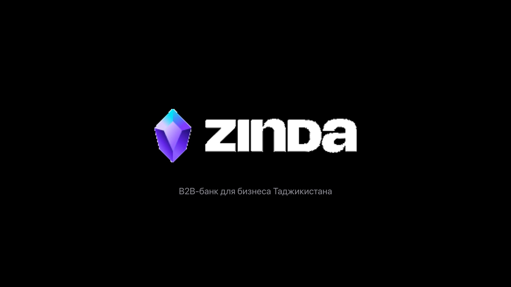

# Zinda: как за четыре месяца собрать B2B-банк для Таджикистана

**Продукт:** B2B-банк, iOS, Android, веб
**Роль:** продуктовый дизайнер и дизайн-лид, команда из трёх дизайнеров
**Что делал:** архитектура сервисов, дизайн-система, сценарии, ревью

## Что означает слово Zinda

«Зинда» в таджикском и персидском значит «живой». Банк построил на этом всю коммуникацию: «для жизни, для бизнеса». Название задало и тон интерфейса: не казённый банковский портал, а живой рабочий инструмент предпринимателя.

## Кратко о проекте

Zinda — коммерческий банк в Душанбе. Это B2B-финтех без розницы: работает только с бизнесом, от фрилансеров и индивидуальных предпринимателей до компаний со штатом и несколькими счетами. До проекта цифрового продукта не было: счёт открывали в отделении, платёжки приносили на бумаге, зарплату выдавали наличными. Для бизнеса это не просто неудобство: пока счёт не открыт, компания не может платить поставщикам, а зарплата задерживается на дни.

За четыре месяца мы собрали MVP с нуля: два нативных приложения, веб-версию, шесть сервисов, заявки, две темы. Клиенты начали открывать счёт и проводить зарплату с телефона.

Сложность была не в интерфейсе. В Таджикистане своя юридическая грамматика: ҶДММ и ИК вместо ООО и ИП, налоги и госпошлины внутри страны, реестры в XLSM, сканы паспортов, электронная подпись. Ошибка в этих деталях стоит клиенту денег, поэтому половину времени я тратил на разбор требований, а не на макеты.

## Исследование

Процесс шёл в четыре шага: сравнение с конкурентами, карта пути клиента, прототип, итерации после обратной связи. Ориентировались на два банка. Точка дала логику B2B-сервисов: счета, платёжные поручения, зарплатные проекты, витрина продуктов. Т-Банк и его версия для бизнеса показали, как устроен массовый сценарий: главная с балансом, подача продуктов, навигация между сервисами.

Локальную специфику собирал из переписок с заказчиком и его бизнес-требований: как бухгалтер ведёт реестр, что происходит при ошибке в ИНН, почему зарплатный проект может быть только один, как работает налог 13 % и удержания. Часть требований приходила уже во время рисования, и это нормально для такого срока.

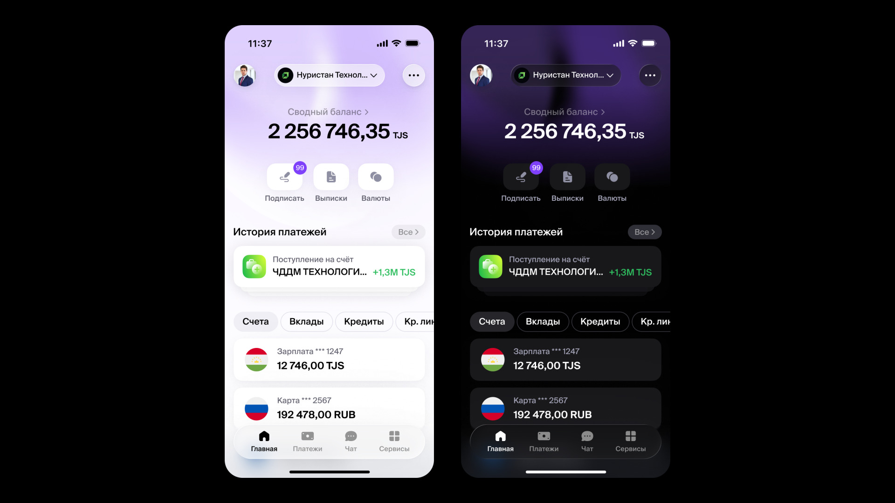

*Две темы одной главной: переключение режимом переменных, а не отдельной вёрсткой*

## Онбординг и вход

Первый запуск решал две задачи: объяснить, что это за банк, и выбрать язык. Русский, таджикский, английский. На onboarding языковой экран стоит последним, поэтому человек сначала видит ценность, а потом настраивает интерфейс.

Вход построен на коротком сценарии: номер телефона, код из SMS, PIN. Face ID и отпечаток доступны после первого входа.

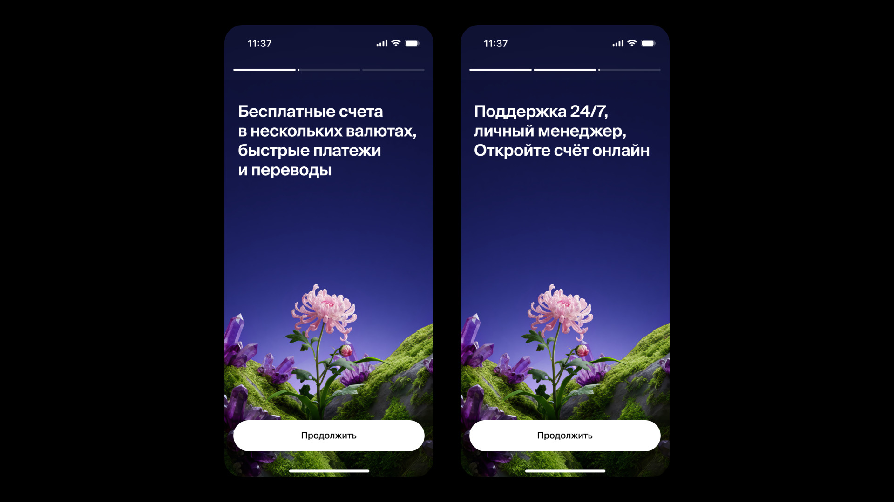

*Онбординг: три экрана, затем выбор языка из трёх*

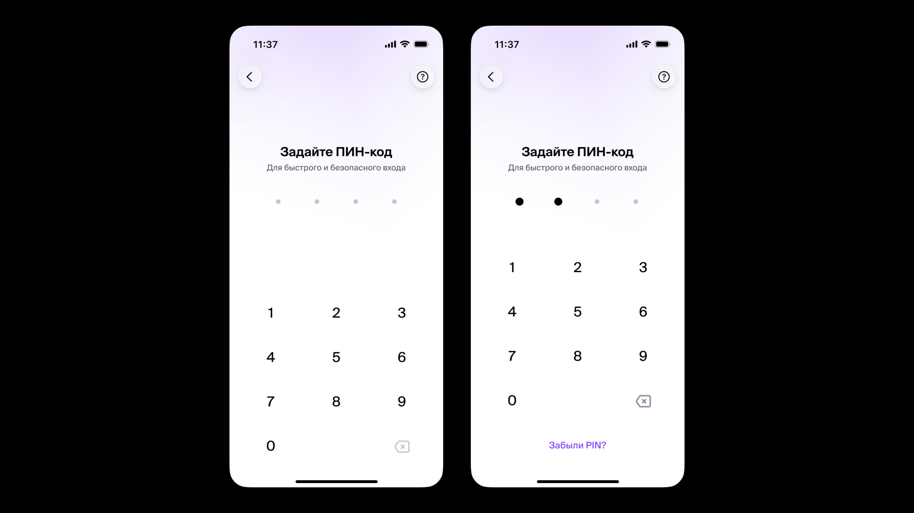

*Ввод PIN: пустое состояние и заполнение точками*

## Процесс

Я начал с user flow по каждому сервису, затем с архитектуры: разложил продукты по пространствам и определил, что живёт на главной, что в сервисах и что уходит в заявки. Дальше собрал дизайн-систему, чтобы три дизайнера могли рисовать параллельно и не расходиться по стилю.

Часть решений проверял на прототипах: по бизнес-требованиям собирал кликабельный прототип и показывал на созвоне, чтобы получить обратную связь до финальных экранов. Брифовал через Qwen, прототипы генерировал в ChatGPT и Codex.

### Витрина как хаб

Продукты живут в одном пространстве «Сервисы»: зарплатный проект крупной карточкой сверху, ниже сетка из депозитов, кредитов, кредитных линий, бизнес-карт и эквайринга. На плитке видно, сколько продуктов у компании открыто. Клиент не помнит свой портфель, и счётчики снимают необходимость проверять каждый раздел.

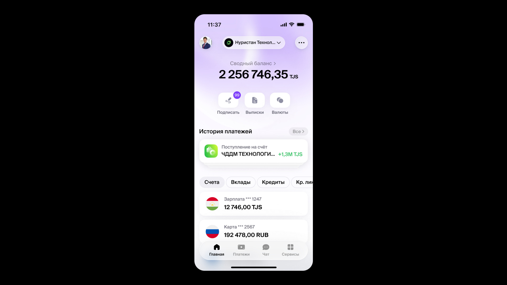

*Главная: сводный баланс в TJS, быстрые действия, история платежей и счета с флагами валют*

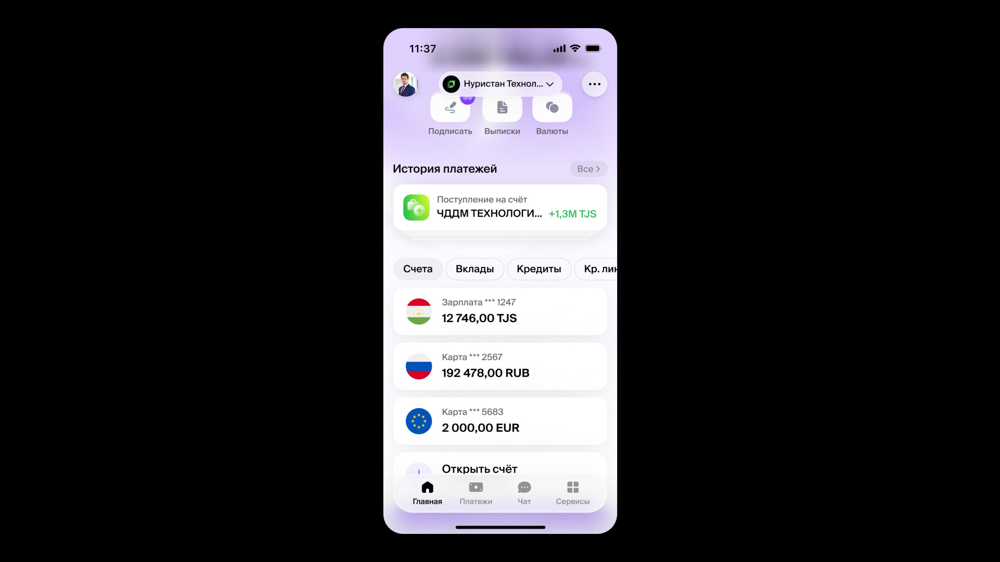

*Главная при прокрутке: счета, вклады и кредиты собираются в одну ленту*

### Депозиты: калькулятор до открытия

Лендинг с условиями виден всегда, даже если депозит открывается третий раз. Дальше калькулятор: валюта, счёт списания, сумма, срок из готовых вариантов, дата открытия и счёт возврата. На выходе ставка, доход и сумма в конце срока.

После открытия появляется таблица депозитов и вкладка «В работе». Внутри депозита история начислений, пополнение, продление и закрытие. Пополнение замораживает сумму на счёте списания, и это неочевидно, поэтому я объяснил механику до подтверждения.

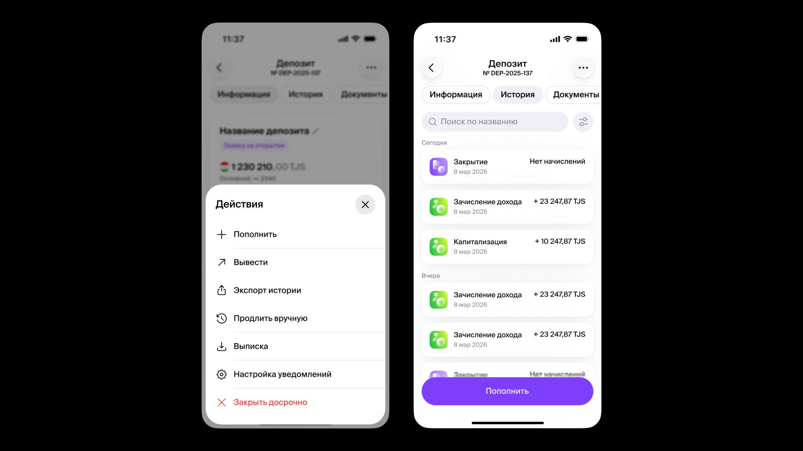

*Страница депозита с историей начислений и экран действий: пополнить, продлить, вывести*

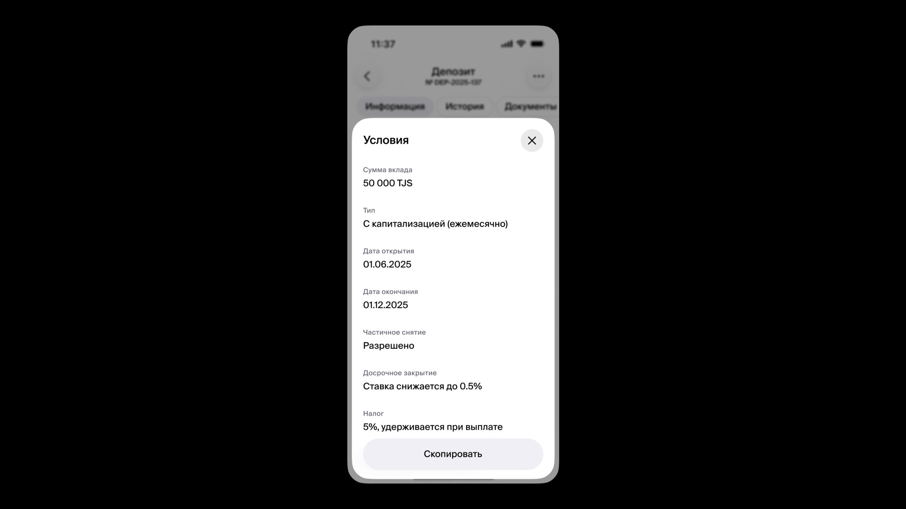

*Условия: ставка, срок, порядок начисления и автопродление в одном экране*

### Зарплатный проект: реестр вместо ручной выдачи

Самый сложный сервис. Бухгалтер заказывает карты оптом: выбирает количество, загружает XLSM с сотрудниками и получает построчную валидацию ошибок. Дальше прикрепляет сканы паспортов и подтверждает заказ.

Выплаты собираются вручную или из файла, проверяются на совпадение ИНН и карты, суммы и лимиты, подписываются и уходят в обработку. Внутри ведомости три вкладки: информация, сотрудники, документы.

Ограничения зашиты в интерфейс: зарплатный проект только один и только в сомони. Второй не создаётся, промо-страница повторно не показывается.

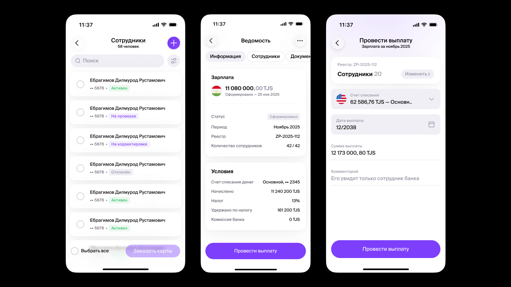

*Список сотрудников, ведомость с налогом и комиссией, экран проведения выплаты*

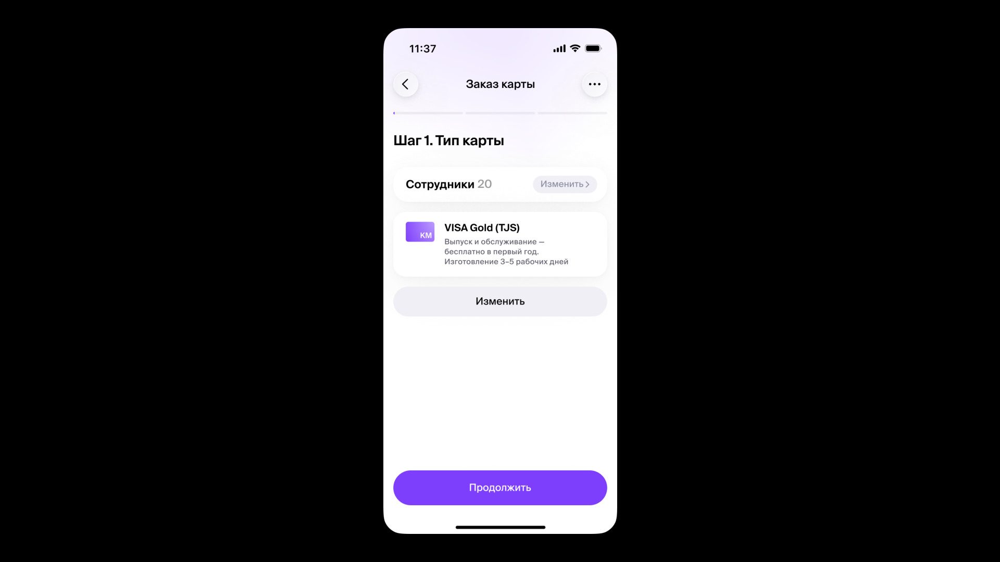

*Заказ карт: тип и количество, дальше загрузка реестра XLSM*

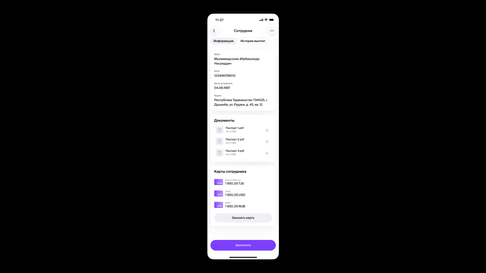

*Карточка сотрудника: карта, выплаты и документы в одном экране*

### Кредиты и кредитные линии

Классический кредит — крупная сумма, заявка со статусами, график платежей и три действия: платить по графику, погасить полностью, досрочно погасить часть.

Кредитная линия работает как лимит, из которого клиент берёт отдельные транши. У каждого транша свой срок и график, общий лимит и остаток видны сразу, плюс запрос на увеличение лимита.

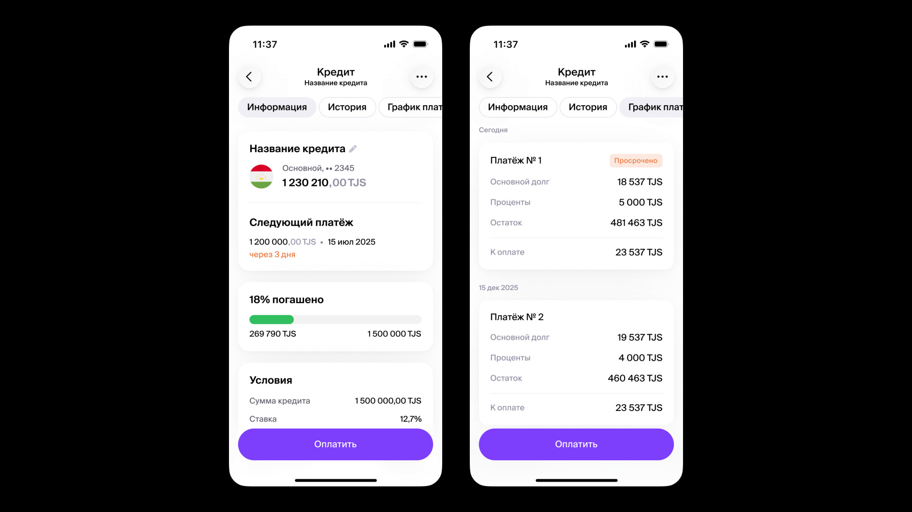

*Страница кредита с остатком долга и график платежей с разбивкой на проценты и тело*

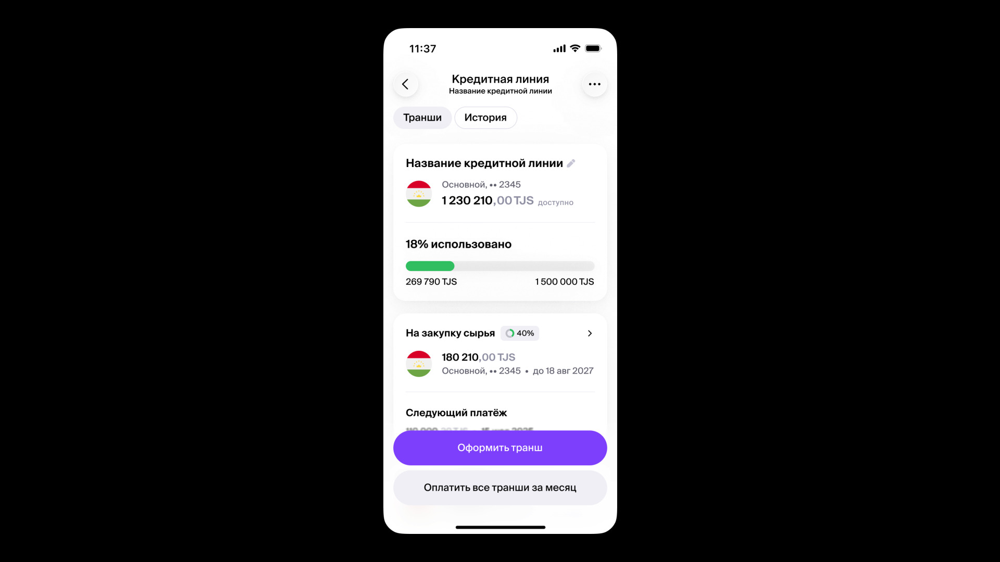

*Кредитная линия: доступный лимит, использовано, транши с отдельными графиками*

### Бизнес-карты

Заказ начинается с типа карты и способа доставки: курьер или самовывоз из офиса. Дальше список карт со статусами и балансом, внутри реквизиты по требованию, история с фильтрами, аналитика расходов и экспорт в PDF или Excel.

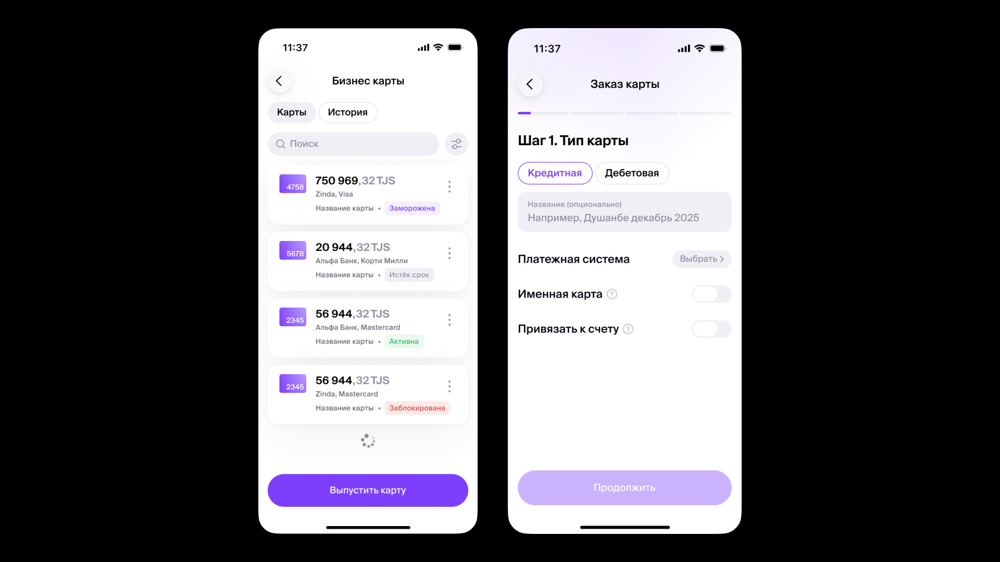

*Список бизнес-карт с балансами и экран заказа: тип карты и способ доставки*

### Заявки

Всё, что нельзя выдать мгновенно, становится заявкой. Список делится на активные и историю, статус понятен без звонка в банк, а если нужны документы, клиент видит, что доделать.

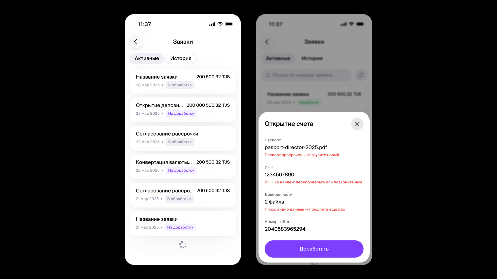

*Заявки со статусами и панель доработки с ошибками по документам*

### Чаты и профиль

Поддержка живёт в чатах: список диалогов, тикет с менеджером, контекстное меню и закрепление. В профиле собраны компания, сотрудники, безопасность, уведомления и переключатель темы, тот самый, что меняет режим переменных.

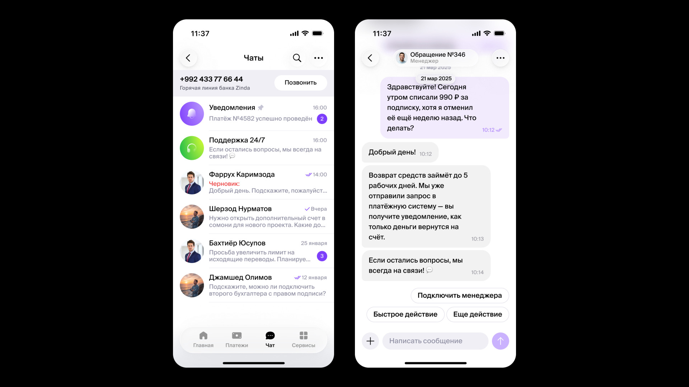

*Чаты: список диалогов и обращение в поддержку*

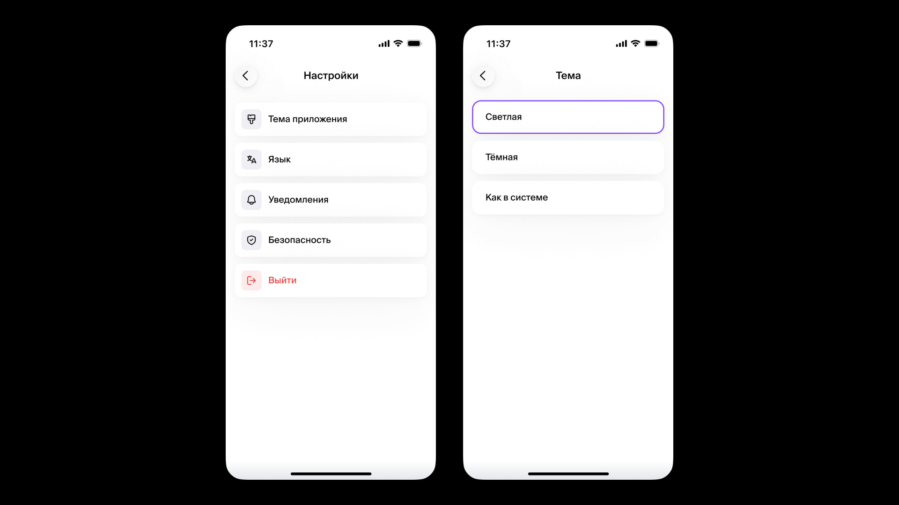

*Профиль и переключатель темы: светлая и тёмная*

## Дизайн-система

Систему я собирал параллельно с первыми экранами: без неё три дизайнера разъехались бы по стилю. Внутри токены, компоненты, спеки и три языковых режима.

Цвета и типографика вынесены в переменные. Тема переключается одним режимом коллекции `theme`: light и dark. Иконки и тексты не дублируются под каждую тему, меняются значения токенов.

Языки живут в отдельной коллекции `text-string` с режимами RU, TJ и EN: один компонент, три значения. Это позволило собрать мультиязычные макеты без копий.

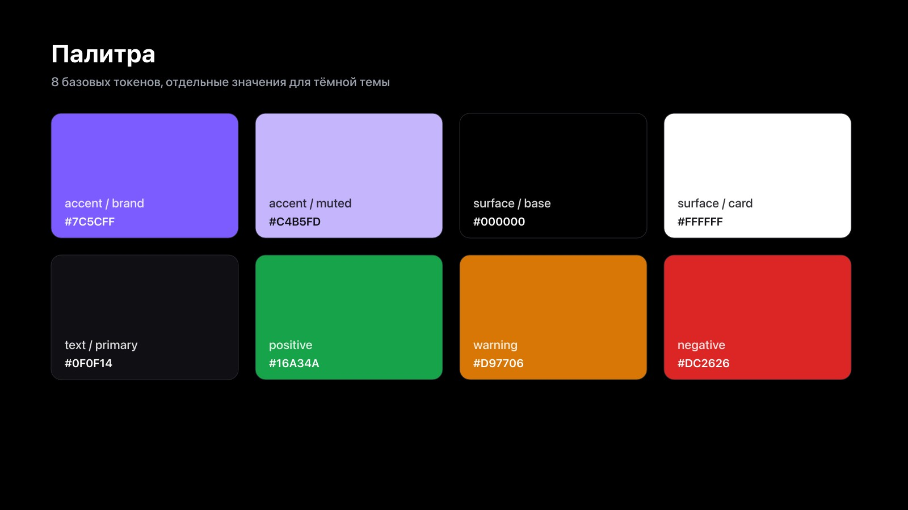

*Палитра: восемь базовых токенов и отдельные значения для тёмной темы*

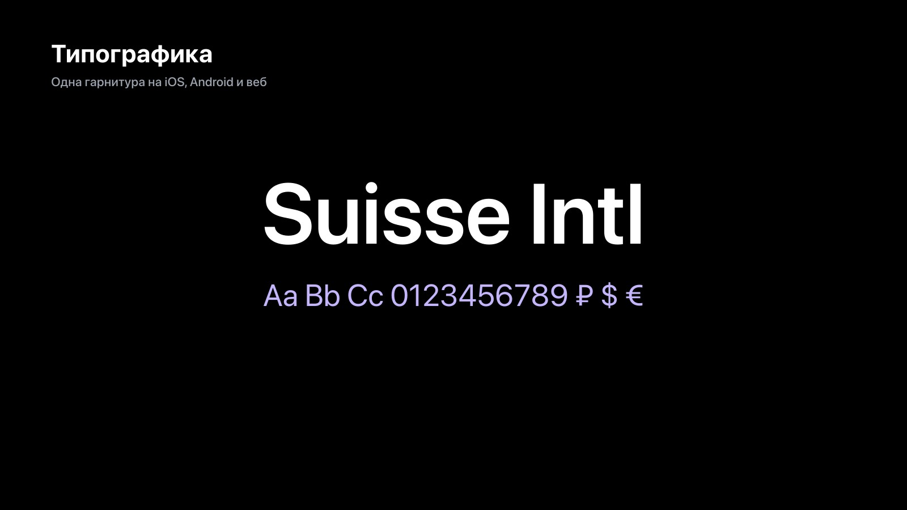

*Suisse Intl: одна гарнитура на iOS, Android и веб*

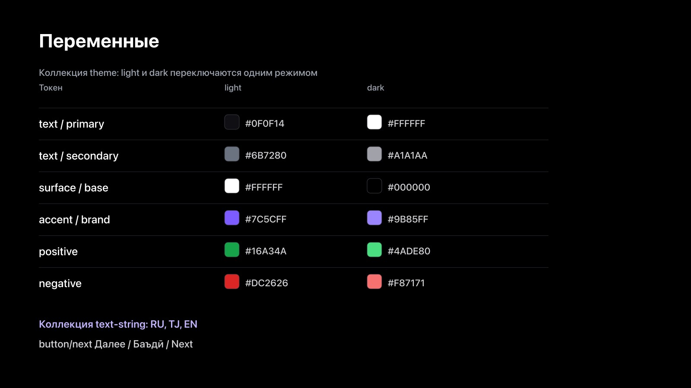

*Коллекция theme для светлой и тёмной темы, коллекция text-string для RU, TJ и EN*

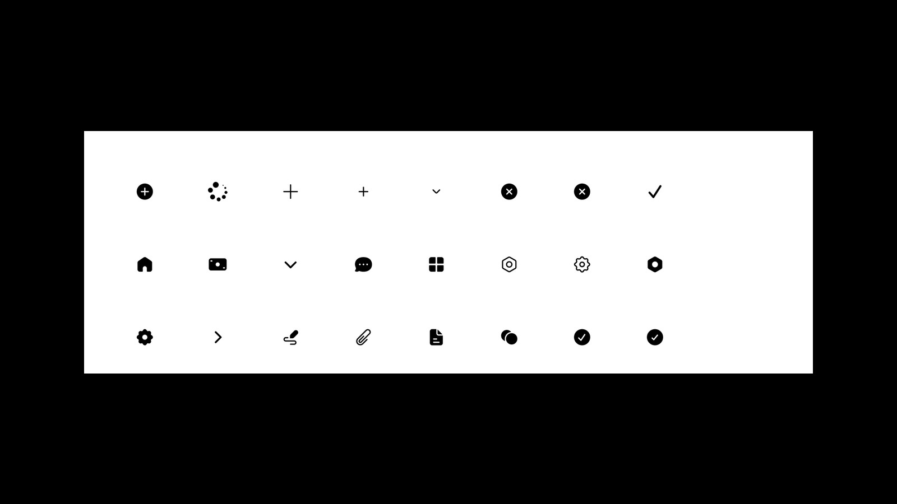

*Иконки: 24 пикселя, единая толщина штриха*

## Веб-версия и модальные окна, которых не будет

Веб делали параллельно на той же системе, но с ограничением от стейкхолдера: никаких модальных окон. В Таджикистане у части пользователей включены блокировщики рекламы, и модалки у них не открываются. Вместо них в вебе живут выезжающие nav-drawer-панели и отдельные страницы.

Ограничение изменило архитектуру: то, что в приложении решается bottom sheet, в вебе стало навигацией. Зато ни один сценарий не ломается из-за расширения браузера.

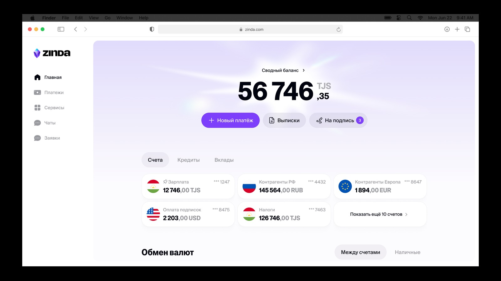

*Веб-версия: сайдбар, сводный баланс, счета в четырёх валютах и обмен*

## Результат

За четыре месяца вышли MVP: главная, платежи, шесть сервисов, заявки, две темы и два нативных приложения. Дизайн-система пережила веб-версию без переработки, а сценарии зарплатного проекта и депозитов прошли согласование с банком без переделки логики.

Продуктовых метрик у меня нет: студия переключилась на другие проекты сразу после сдачи, аналитику собирали уже без нас. Из наблюдаемого: банк начал подключать клиентов к приложению, а поддержка получила готовые экраны статусов вместо звонков «что с моей заявкой».

## Чему научился

- Локальная специфика важнее мировых паттернов: реестр XLSM, налог 13 % и единственный зарплатный проект в TJS определяют продукт сильнее любого гайда.
- Ограничения рынка проверяются до макетов. История с блокировщиками и модалками стоила переделки навигации в вебе.
- Лид в команде из четырёх человек половину времени тратит на формулировки и защиту решений, а не на рисование.
- Переменные и мультиязычные токены экономят недели, если заложить их в первую неделю, а не в конце.

Остальное могу показать на созвоне/собеседовании.

## Команда

Сделано для студии 5x10 студией Паприка, ноябрь 2025 — февраль 2026

- Дизайн-лид — Сергей Фёдоров
- Продуктовые дизайнеры — Азиза Рахимова, Дмитрий Ковалёв, Марина Юсупова
- Арт-директор — Илья Соколов
- Продуктовый менеджер со стороны банка — Фарход Назаров
