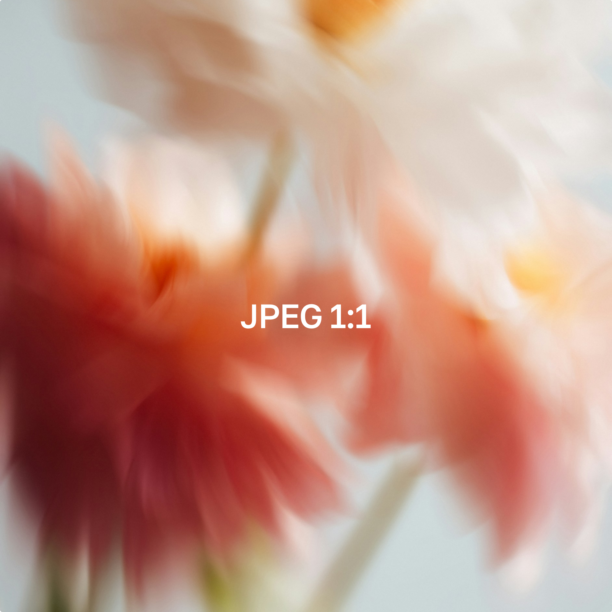
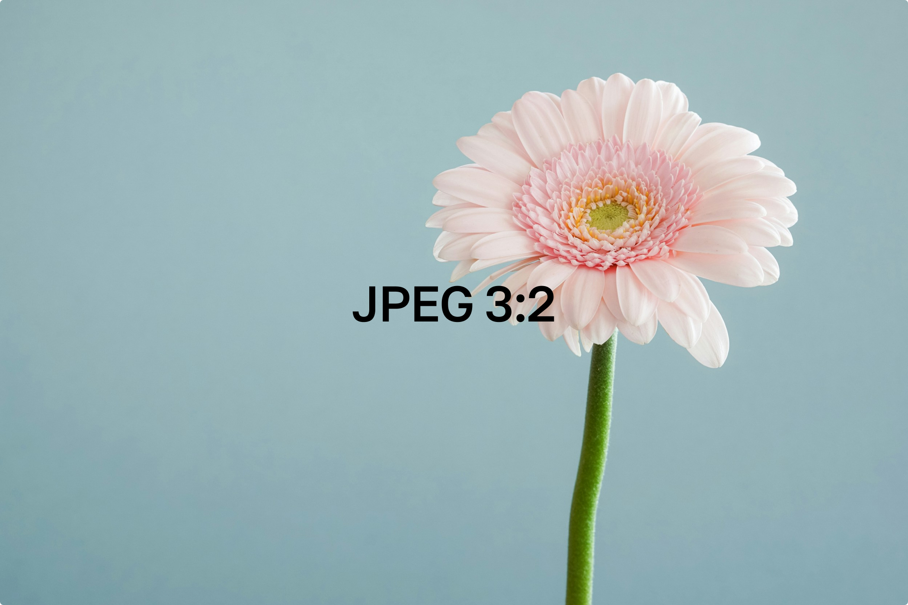

# Бренд-айдентика — Liqesis

**Демонстрационный кейс.** Ниже — вымышленные задачи, решения и результаты для проверки вёрстки. Изображения и видео — тестовые материалы. Направление проекта: визуальная система и интерфейс цифрового сервиса.

## Цель

Сократить путь от первого знакомства с продуктом до завершения ключевого действия. Команда хотела сделать интерфейс понятным для новых пользователей и сохранить привычные сценарии для опытных. Мы договорились проверять решения на задачах, а не оценивать их только по внешнему виду.

## Результаты

В учебном примере доля успешно выполненных заданий выросла с **62% до 84%**, а медианное время прохождения сценария сократилось с **4 минут до 2,5 минут**. Это условные цифры, а не результаты реального проекта. Команда получила прототип, библиотеку компонентов и список гипотез для следующей итерации.

## Моя роль в проекте

Я отвечал за исследование, структуру сценариев, интерактивный прототип и визуальный дизайн. Вместе с продакт-менеджером сформулировал критерии успеха, с разработчиками обсудил ограничения, а после тестирования подготовил спецификацию состояний и проверил сборку.

## Процесс

Мы начали с разбора текущего пути пользователя и собрали вопросы, на которые не могли ответить по аналитике.
Затем провели несколько интервью и попросили участников показать, как они решают задачу сегодня.
Важно было увидеть реальные обходные пути, а не только услышать пожелания к будущему интерфейсу.
Наблюдения сгруппировали по этапам сценария и отдельно отметили места, где человек терял контекст.
Для обсуждения подготовили [интерактивный прототип в Figma](https://www.figma.com/) и короткий список проверяемых гипотез.
На первой итерации мы сократили число обязательных полей и перенесли вспомогательные действия в дополнительные настройки.
После этого сравнили два варианта навигации и проверили, понимают ли участники названия разделов без подсказок.
Ошибки и пустые состояния проектировали одновременно с основным сценарием, чтобы пользователь всегда видел следующий шаг.
Решения обсуждали с разработчиками небольшими порциями и фиксировали причины выбора в комментариях к макету.
Отдельное внимание уделили клавиатурной навигации, контрасту и принципам [доступного интерфейса](https://www.w3.org/WAI/fundamentals/accessibility-intro/).
В финале повторили тестирование на обновлённом прототипе и разделили замечания на критические и те, что можно проверить после запуска.
Так появился план следующей итерации с понятными владельцами задач и критериями готовности.

После первой проверки мы не стали менять весь интерфейс сразу. Выбрали один основной сценарий и довели его до состояния, в котором можно проверить гипотезу. Это помогло отделить проблемы структуры от вопросов визуального оформления. Остальные идеи сохранили в бэклоге и связали с конкретными наблюдениями из интервью.

### Что изменили

| Наблюдение | Решение |
| --- | --- |
| Пользователи не замечали основное действие | Сделали его заметнее и уточнили название |
| Форма требовала слишком много данных | Оставили обязательными только необходимые поля |
| После ошибки было непонятно, как продолжить | Добавили объяснение и действие для восстановления |
| Длинные названия ломали узкие экраны | Проверили переносы и адаптивные состояния |

### Сравнение сценариев

Демонстрационные данные для широкой таблицы. Если она не помещается, прокрутите её по горизонтали.

| Сценарий | Аудитория | Устройство | Участники | Успех до | Успех после | Время до | Время после | Основная проблема | Решение |
| --- | --- | --- | --- | --- | --- | --- | --- | --- | --- |
| Первый вход | Новые пользователи | Телефон | 8 | 50% | 88% | 2 мин 40 с | 1 мин 20 с | Слишком много обязательных полей | Сократили форму регистрации |
| Поиск нужного раздела | Активные пользователи | Ноутбук | 10 | 60% | 90% | 1 мин 30 с | 45 с | Неочевидные названия пунктов меню | Перегруппировали навигацию |
| Настройка профиля | Все пользователи | Планшет | 6 | 67% | 83% | 3 мин | 1 мин 50 с | Настройки разбросаны по разным экранам | Собрали их в одном разделе |
| Восстановление после ошибки | Повторные пользователи | Телефон | 8 | 38% | 88% | 2 мин 10 с | 35 с | Непонятно, что делать дальше | Добавили объяснение и повтор действия |

### Принципы решения

- Один главный сценарий на каждом этапе.
- Понятные подписи вместо внутренних терминов команды.
- Сохранение введённых данных при ошибке.
- Предсказуемые состояния компонентов:
  - загрузка;
  - пустой результат;
  - ошибка и повторная попытка.

### Последовательность работы

1. Сформулировали задачу и ограничения.
2. Собрали наблюдения и карту сценария.
3. Подготовили прототип и провели тестирование.
4. Уточнили дизайн и передали спецификацию.
5. Проверили реализацию и составили план улучшений.

#### Движение и обратная связь

GIF ниже нужен для проверки анимированных иллюстраций. В реальном кейсе здесь может быть переход между состояниями интерфейса.

#### Видео прототипа

Видео запускается вручную: доступны звук, пауза, перемотка и полноэкранный режим.

<video controls playsinline preload="metadata" src="assets/demo.mp4" poster="assets/cover.jpg"></video>

*Тестовая видеозапись для проверки плеера в статье.*

##### Детали интерфейса

###### Что проверим дальше

Проверим, сохраняются ли улучшения на более широкой аудитории и какие сценарии требуют отдельной итерации.

> Хороший результат исследования — не список пожеланий, а ясное понимание проблемы и способ проверить решение.

---

**Материалы:** [обсудить проект](https://t.me/fedoros/1145), [другой пример кейса](../design-system/design-system-case.md).
