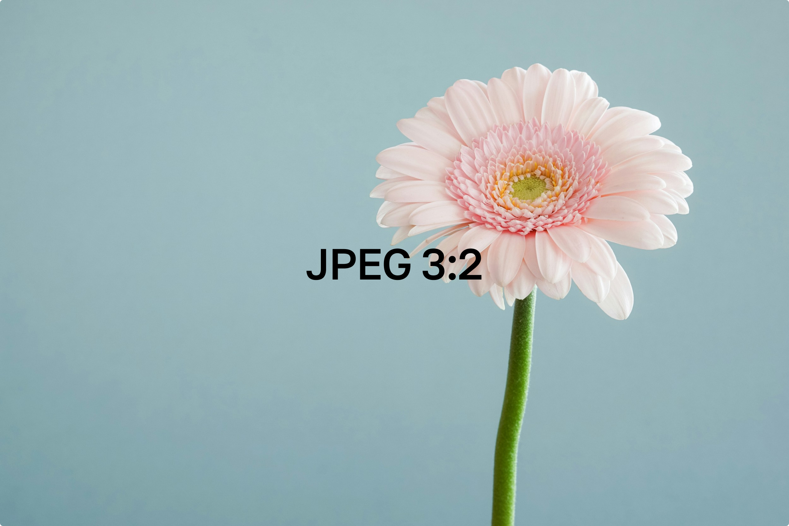

# Натали&nbsp;— оптовый маркетплейс

Оптовый маркетплейс: поставщики выкладывают товар, закупщики магазинов и HoReCa собирают заказ и отправляют заявку. До проекта каталог жил в прайс-листах, а заказы — в мессенджерах. Роль — продуктовый дизайнер: каталог, карточка товара, корзина-заявка, кабинет поставщика.

## Задача

Закупку нужно было перевести в интерфейс, сохранив менеджера, который согласует условия. Каталог должен показывать оптовые цены и остатки, корзина — становиться заявкой, а не мгновенной оплатой, поставщик — обрабатывать заявки сам.

Цель: сократить путь от поиска товара до заявки и убрать ручной перенос позиций из переписки.

## Моя роль

Продуктовый дизайнер. Вёл исследование закупщиков, проектировал каталог, карточку товара, корзину-заявку и кабинет поставщика. Работал с продактом и разработкой, проверял гипотезы на прототипах.

## Процесс

Сегменты. Три группы закупщиков: небольшой магазин, кафе и рестораны, крупные оптовики. Первым важны цена и наличие, вторым — регулярность и сроки, третьим — объём и отсрочка. Для каждой группы свой первый экран.

Каталог. Оптовая цена и пороги видны в списке: цена за единицу меняется от объёма. Добавлены остатки, кратность упаковки и похожие товары.

Заявка вместо оплаты. Корзина превращается в заявку: дата и адрес доставки, подтверждение условий менеджером, оплата по договору. Схема осталась привычной для рынка, но без переписки и пересылки списков.

Кабинет поставщика. Список заявок с фильтром по срокам и статусами: новая, подтверждена, собрана, отгружена. Отдельно — загрузка прайса и управление остатками.

## Что изменилось

- Поиск товара: прайс и уточнение наличия в мессенджере → каталог с остатками и оптовыми порогами.
- Заказ: переписка и ручной перенос позиций → заявка из корзины с датой и адресом.
- Цена: «уточните у менеджера» → видимая шкала от объёма.
- Поставщик: заявки в разных чатах → один список со статусами.

## Результаты

- Оформление заявки: около 12 минут → 5 минут.
- Конверсия из просмотра каталога в заявку выросла примерно на 18% в пилоте.
- Ручной перенос позиций из переписки убран полностью.
- Поставщики обрабатывают заявки в кабинете, без звонка менеджеру.

<video controls playsinline preload="metadata" src="assets/demo.mp4" poster="assets/cover.jpg"></video>

